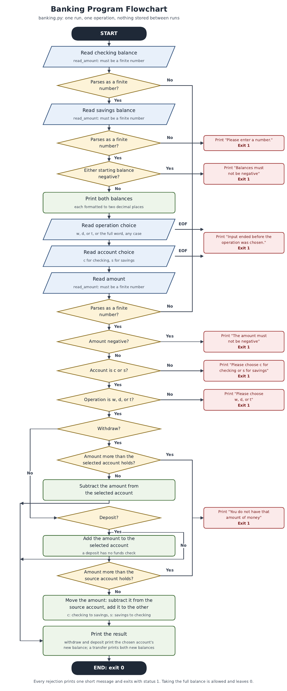

<p align="center"></p>

<div align="center">
  <p></p>
  <h1>Banking-Program</h1>
  <p><strong>The Little Ledger</strong><br>
  <em>A tiny clay bank in sage and brass, where coins roll from one vault to the other and the balance scale stays level at the center.</em></p>
  <p>
    
    
    
    
  </p>
</div>

A small interactive banking program in Python. It works with a checking account and a savings account for a single run: you enter both starting balances, choose one operation and one account, enter an amount, and the program prints the resulting balance. Nothing is saved between runs.


## Quick Start

Requires Python 3. The program uses only the standard library (`math` and `sys`), so there is nothing to install.

```bash
# Run the interactive program
python3 banking.py

# Run the test suite
python3 -m unittest
```

The test suite covers the operation math and scripted runs.


## What it asks, in order

1. The balance of your checking account (a number).
2. The balance of your savings account (a number).
3. Whether you want to withdraw, deposit, or transfer: `w`, `d`, or `t` (the full words `withdraw`, `deposit`, and `transfer` also work, in any case).
4. Which account to use: `c` for checking or `s` for savings (any case).
5. The amount of money for the operation (a number, not negative).

The program first prints both balances back, with checking shown as checking and savings shown as savings.



*Flowchart for the program, exported from `Flowchart.pdf`.*


## What each operation does

<!-- deco -->
> **Watch order, chalked on the slate:** amounts larger than the source balance are refused with the words chalked in the section below, and every fault leaves by status 1.
<!-- /deco -->

| Operation | Input | Behavior | Overdraft Check |
|---|---|---|---|
| Withdraw | `w` (or `withdraw`) | Subtracts the amount from the selected account and prints its new balance. Only the selected account is checked. | If the amount is more than the selected account holds, it prints "You do not have that amount of money" and exits. |
| Deposit | `d` (or `deposit`) | Adds the amount to the selected account and prints its new balance. | A deposit has no upper limit based on the current balances. |
| Transfer | `t` (or `transfer`) | Moves the amount out of the selected account and into the other one, and prints both new balances. Choosing `c` transfers from checking to savings; choosing `s` transfers from savings to checking. | If the amount is more than the source account holds, it prints "You do not have that amount of money" and exits. |


*Transfer illustration: `assets/banner.png`, shown here in this section.*

### Input Validation

- Non-numeric input for a balance or amount, a non-finite value such as `inf`, or closed input (EOF) prints "Please enter a number." and exits with status 1 instead of showing a traceback.
- An account choice other than `c` or `s` is reported with a short message and exits with status 1: "Please choose c for checking or s for savings".
- An action choice other than `w`, `d`, or `t` is reported with a short message and exits with status 1: "Please choose w, d, or t".
- A negative amount is reported with a short message and exits with status 1: "The amount must not be negative".
- A negative starting balance is reported with a short message and exits with status 1: "Balances must not be negative".
- An amount larger than the source balance is reported with a short message and exits with status 1: "You do not have that amount of money".
- Balances print to two decimal places.

Example session, captured by running `printf '100\n1000\nw\nc\n50\n' | python3 banking.py`:

```

 What is the balance of your checking account? 

 What is the balance of your savings account? 
--------------------------------------

 Your checking balance is equal to 
100.00

 Your savings balance is equal to 
1000.00
--------------------------------------

 Would you like to withdraw your money, deposit or transfer your money w/d/t 

 Which account would you like to access checking or savings account? c/s 

 What amount of money would you like to withdraw, deposit, or transfer? 

 You have a selected a withdraw 

Doing a withdraw of:  50.00

 Doing a withdraw from checking account your new balance is: 

50.00
```

Example inputs and outputs:

| Checking | Savings | Action | Account | Amount | Resulting Output |
|---|---|---|---|---|---|
| 100 | 1000 | w (Withdraw) | c | 50 | Checking: 50.00 |
| 100 | 1000 | d (Deposit) | c | 50 | Checking: 150.00 |
| 100 | 1000 | t (Transfer) | s | 50 | Savings: 950.00, Checking: 150.00 |


## Files

- `banking.py`: the program.
- `test_banking.py`: tests for the operation math and scripted runs.
- `Flowchart.pdf`: a flowchart for the program.
- `flowchart.png`: PNG export of `Flowchart.pdf`, shown under "What it asks, in order".
- `intro-banner.png`: hero image shown at the top of this README.
- `logo.png`: logo shown in the header at 120px.
- `assets/banner.png`: project branding, shown in "What each operation does" as the Transfer illustration.
- `assets/logo.png`: project branding, in the repo but not displayed in this README.
- `sep-light.svg`: separator shown between major sections in this README.
- `assets-scene.svg` and `sep-heavy.svg`: in the repo but not displayed in this README.


## License

GPL-3.0; see `LICENSE`.
